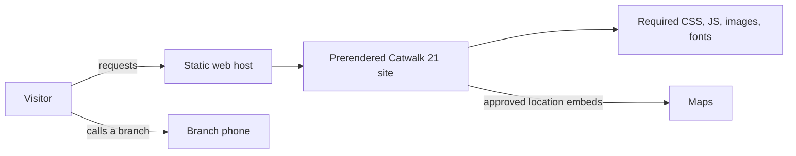

# Architecture improvements

## Complexity hotspots

1. **Unsafe, disconnected mail endpoint — `contact.php`, `js/common.js`, `index.html`.** The endpoint accepts GET and POST values without robust validation, uses the submitted name/email in the mail `From` header, and inserts unescaped values into an HTML email. Its recipient is a template-provider address. Meanwhile, the current page has no form, so the submission path is not a working site feature. This creates mail-header injection, data exposure through URLs, abuse, and lost-message risks if the endpoint is reachable.
2. **Two unrelated site experiences — `index.html`, `blog.html`, `css/style.css`, `js/nicescroll.js`.** `blog.html` is a leftover Beauttio template, with placeholder New York content, unrelated booking details, external assets, and broken/placeholder links. It misrepresents the salon and expands the number of things to maintain.
3. **Unused and overlapping frontend code — `js/home.js`, `js/testimonials.js`, `js/stylish-portfolio.min.js`, other template assets.** The main page loads only `stylish-portfolio.js`, `common.js`, and the fireworks scripts; it does not load `home.js` or `testimonials.js`. The common file contains contact-form logic for markup that is absent. Keep only code that supports intended, reachable pages and behaviors.
4. **No delivery or test contract — repository root.** There is no `package.json`, test runner, deployment config, or CI workflow, and the PHP runtime/mail setup is undocumented. Changes can be deployed without a basic check that local asset references resolve or that the page still renders.
5. **Third-party runtime coupling — `index.html`.** Google Fonts, Google Maps, and Meta Pixel are requested from the browser. A visitor's page behavior and privacy exposure depend on external services and browser policy. Keep these only if they serve an explicit business need and consent/privacy requirements are addressed.

## Target architecture

Rebuild as a prerendered SvelteKit marketing site on the existing Hostinger Single Web Hosting plan. Do not add a Node server, database, booking system, CMS, or contact endpoint. Remove the legacy blog/template pieces; keep the logo artwork unchanged. Use branch-specific call links, and add WhatsApp only after the numbers are confirmed. Review existing copy and photography before launch.

Compared with today:

- **Remove** the unused legacy Beauttio blog and its resources, or replace it with real Catwalk 21 content if the blog is a requirement.
- **Remove** scripts and dependencies that no reachable page uses; keep vendored files that the page actually references.
- **Remove** the disconnected PHP mail endpoint; use phone links until a new contact requirement is agreed.
- **Keep** the existing static hosting model. Build SvelteKit in CI and deploy only its static output; see `docs/adr/0001-prerendered-sveltekit-on-hostinger.md`.

## Testing, CI/CD, and deployment plan

### Tests

- Add a lightweight link/asset-reference check for `index.html` and any retained secondary page.
- Verify the published artifact contains no `contact.php` or leftover template files; inspect the live host after deployment too, since Git deployment may not prune old files.
- Smoke-test the homepage and contact links in a browser after deployment. Verify maps and analytics only under the intended privacy/consent behavior.

### CI/CD

- No CI exists. Add a pipeline that installs locked dependencies, builds the SvelteKit site, checks its generated pages and asset references, and publishes only the static output to `master`, which Hostinger currently deploys.
- Hostinger's classic Git connector copies repository files to `public_html` without building; point it at the artifact branch. Verify whether it deletes stale files before cutover.

### Environments, data, and rollback

- Document the Hostinger Git mapping (`master` to `public_html`); keep SvelteKit source on `main`. Store CI credentials in the CI secret store, never in the repository. The static site needs no PHP runtime, database, or migrations.
- Preview the generated site before the first artifact push to `master`; retain the old release for rollback. Verify and remove leftover `contact.php` and template files if Hostinger does not prune deleted files.

## Task list

| ID | Priority | Task | Why | Files | Effort | Depends on | Done when |
|---|---|---|---|---|---|---|---|
| A1 | P0 | Remove the PHP mail endpoint from the deployed site; replace it with branch-specific call links. | Existing endpoint sends to a template address and accepts untrusted input; confirm no live traffic relies on it before removal. | `contact.php`, `index.html`, `js/common.js`, SvelteKit pages | M | None | No PHP mail route remains public; branch phone links use verified numbers. |
| A2 | P1 | Remove the placeholder blog; redirect its URL if it has traffic. | Template copy and stale contact details damage trust; removing the public URL can break inbound links. | `blog.html`, `css/style.css`, `js/nicescroll.js`, hosting redirects | S–M | URL usage check | Every public page contains approved Catwalk 21 content and old links resolve or redirect. |
| A3 | P1 | Build the marketing pages in SvelteKit; carry over only approved copy, images, and the unchanged logo. | Replaces the legacy template without shipping its unused scripts or speculative features. | SvelteKit app, `img/`, `index.html`, `vendor/`, `css/` | M | A1, A2 | Generated site works on mobile and desktop; content and branch details are approved. |
| A4 | P2 | Create `main` for SvelteKit source; add CI to build and publish generated static output to `master` after preview. | Hostinger already deploys `master` without building. Verify file pruning and retain rollback before the first artifact push, or old PHP/template files may stay public. | `package.json`, lockfile, SvelteKit config, CI config, hosting settings | M | A3 | CI builds and checks the output; Hostinger serves generated files from `master` and rollback is documented. |
| A5 | P2 | Confirm need and privacy behavior for Meta Pixel and external embeds. | Third parties receive browser requests and may affect consent/privacy obligations. Removing or gating them may alter analytics or map usability. | `index.html` | S | Business/privacy decision | External services are either justified and handled under approved policy or removed/gated. |

## Open decisions

1. **Deployment cleanup:** Does Hostinger remove files deleted from `master` on deployment, or only add/overwrite files? **Default:** assume it does not prune; back up and explicitly remove obsolete PHP/template files after preview and before launch.
2. **Legacy blog URL:** Redirect it to the homepage or return a removal response. **Default:** redirect if the URL has traffic or inbound links.
3. **Analytics and maps:** Keep both, keep maps but remove/gate analytics, or remove both. **Default:** retain useful location maps and retain tracking only after privacy/consent approval.

## Inspection limits

This is based on repository inspection and the owner's description of Hostinger Single Web Hosting and its classic Git connector, not a live hosting audit or proof of security. File-pruning behavior, the live site, PHP runtime, email delivery, browser session, and CI were not inspected or run. PHP CLI was unavailable; graph extraction required an API key, so source files were inspected directly.
