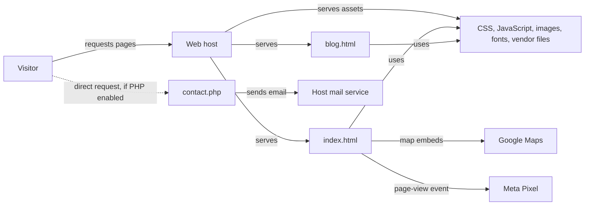

# Architecture

## Purpose

Catwalk 21 is a small salon-and-spa marketing site. It presents services, two Mumbai branch locations, and contact details to prospective customers. The main page is static HTML; a legacy PHP endpoint can send contact messages, but the current pages do not expose a contact form.

## Component diagram

## Components

- **Web host:** Serves files; it must execute PHP for `contact.php` to work.
- **Home page (`index.html`):** Main salon landing page, with services, branch map carousel, addresses, and contact information.
- **Blog page (`blog.html`):** Separate, uncustomized template page with placeholder salon copy and third-party links.
- **Static assets:** Bootstrap, jQuery, local styles, scripts, images, fonts, and icons used by the pages.
- **Contact endpoint (`contact.php`):** Reads `name`, `email`, and `comment` and attempts to send an HTML email with PHP `mail()`.
- **External services:** Google Maps renders location embeds; Meta Pixel receives a page-view event. PHP mail delivery depends on host configuration.

### Typical page visit

1. The web host returns `index.html` and its local CSS, scripts, images, and fonts.
2. The browser renders the salon content and runs the local navigation, scroll, loader, and fireworks scripts.
3. The browser requests Google Maps embeds and sends a page-view event to Meta when external connections are allowed.

The contact endpoint is not part of this page flow. `js/common.js` contains AJAX contact-form logic, but `index.html` has no matching form or submit controls.

## Key files

| File/directory | Component | Role |
|---|---|---|
| `index.html` | Home page | Main content, map embeds, tracking script, and asset entry points |
| `blog.html` | Blog page | Legacy template content; still includes template-specific external resources |
| `contact.php` | Contact endpoint | Accepts request parameters and calls `mail()` |
| `js/stylish-portfolio.js` | Home behavior | Sidebar navigation, smooth scrolling, scroll-to-top, and map interaction |
| `js/common.js` | Legacy shared behavior | Contact-form AJAX/validation code and page-loader/menu setup |
| `js/animation.js`, `js/anime.min.js` | Home animation | Canvas fireworks animation and bundled animation library |
| `css/stylish-portfolio.css`, `css/loader.css` | Home styles | Main page styling and loader |
| `css/style.css`, `js/nicescroll.js` | Blog template | Blog styles and legacy scrolling support |
| `vendor/` | Local frontend dependencies | Bootstrap, jQuery, Font Awesome, Simple Line Icons, and jQuery Easing |
| `img/`, `fonts/` | Static assets | Brand marks, photography, and custom font files |
| `package-lock.json` | Node metadata | Locks `animejs`, but there is no `package.json` or build script in the repository |
| `license.html`, `license.txt` | Template/license material | Third-party template attribution and license text |

## Setup and gaps

- **Stack:** Static HTML/CSS/JavaScript with vendored Bootstrap and jQuery; optional PHP mail endpoint.
- **Run:** Serve the repository root with any static HTTP server for the pages. A PHP-capable web server is required to execute `contact.php`. No project-specific start command is defined.
- **Test/build:** No test suite, build script, or package manifest is present. `package-lock.json` alone does not define a reproducible Node project.
- **Deploy:** No CI/CD, hosting, environment, or rollback configuration is checked in. Hosting provider and PHP/mail configuration are unknown.
- **Not established:** Whether the PHP endpoint is deployed, whether `blog.html` is intentionally public, and whether the analytics and map embeds have current privacy approval. The project graph was not available: graph extraction was attempted but stopped because semantic extraction required an API key; conclusions here come from direct source inspection.
